# Device registry

**Status:** Implemented locally (P1b.4b registry/credentials; P1b.4c pairing/enrollment).
Remote enrollment and network access remain disabled. Implementation details:
`docs/architecture/device-registry-implementation.md` and
`docs/architecture/device-pairing-implementation.md`.

## Purpose

Authoritative inventory of **clients** allowed to use Chief of Staff capabilities
against `cosd`, independent of Tailscale membership or local filesystem access.

## Non-goals (current)

- No enrollment UI or QR pairing.
- No remote clients or remote credential distribution.
- No hardware fingerprinting beyond optional user-supplied platform strings.

## Device record

| Field | Type | Notes |
| --- | --- | --- |
| `device_id` | 32-char hex (UUID4) | Primary key; random, generated once; never derived from IP, MAC, or name |
| `display_name` | string | User-editable, 1–80 characters |
| `device_type` | enum | `mac`, `iphone`, `ipad`, `other` |
| `platform` | enum | `macos`, `ios`, `ipados`, `unknown` |
| `owner_id` | string | `owen`, `partner`, `school`, `unassigned`, … |
| `device_profile` | enum | `owner`, `personal`, `partner`, `school`, `read_only`, `capture_only`, `revoked` |
| `trust_level` | enum | `owner`, `trusted`, `limited`, `restricted`, `untrusted` |
| `status` | enum | `active`, `disabled`, `revoked`, `removed` |
| `app_version` | string | Last reported client build |
| `registered_at` | ISO8601 UTC | Enrollment timestamp |
| `last_seen_at` | ISO8601 UTC | Last successful device authentication |
| `updated_at` | ISO8601 UTC | Last metadata update |
| `revoked_at` | ISO8601 UTC | Revocation timestamp |
| `metadata_json` | JSON object | Bounded, non-sensitive tags; secret-like and student/PII-like keys refused |
| `is_primary_owner` | boolean | At most one primary owner (unique partial index) |

**Revoked** devices remain in the registry until explicitly removed;
`status=revoked` blocks all device paths. Removal deletes the registry row only
after disable/revoke, while `device_events` and the JSONL audit retain
provenance.

## Storage

- Same database file as the task registry: `<state>/cosd/tasks.sqlite3`.
- Versioned by `schema_meta.device_schema_version`; independent of the task
  schema so a device migration failure does not stop the local daemon.
- `device_credentials`: only `credential_id`, `device_id`, `credential_type`,
  `keychain_ref`, salted one-way verifier, status, and lifecycle timestamps —
  **never** the secret bytes.
- Secrets: macOS login Keychain on the primary Mac; no plaintext fallback.

## Lifecycle

```mermaid
stateDiagram-v2
  [*] --> active: register / bootstrap with owner confirmation
  active --> disabled: owner suspend
  disabled --> active: re-enable (same identity)
  active --> revoked: owner revoke
  disabled --> revoked: owner revoke
  revoked --> [*]: remove (row deleted; audit retained)
  disabled --> [*]: remove (row deleted; audit retained)
```

The primary owner device is protected from disable/revoke/remove/profile
downgrade. Recovery requires the exact phrase `RECOVER PRIMARY OWNER`, then a
new bootstrap.

## Permission profiles

| Profile | Capabilities |
| --- | --- |
| `owner` | Full authorized control, including device and credential administration |
| `personal` | Approved personal workflows; no administration |
| `partner` | Explicitly shared ask/task capabilities; no private history, execution, or administration |
| `school` | Restricted ask, task capture, status only; no history/sessions/execution/administration |
| `read_only` | Status and task history; no mutation |
| `capture_only` | Create tasks; no ask, read, or execution |
| `revoked` | No access |

No profile inherits from `owner`. Unknown profiles/permissions fail closed.
Full matrix: `cosd/devices/permissions.py`.

## Management surface

Chief.app **Devices** (local owner only): list, detail, rename, change profile,
disable, re-enable, revoke, remove, credential rotate/revoke, primary bootstrap,
and **Add Device / Pending Enrollments** (P1b.4c). Profile and lifecycle changes
require confirmation.

## Pairing and enrollment (P1b.4c)

Owner-created pairing invitations produce a one-time 60-bit code and QR payload
(no master token, private key, or permanent credential). The device redeems with
its X25519 public key; the owner explicitly approves the profile; the daemon
issues a P1b.4b credential and encrypts the delivery payload with X25519 +
HKDF-SHA256 + AES-256-GCM. Codes expire within 10 minutes, are single-use,
salted-hash verified, rate-limited, and replay-audited. Re-pairing requires an
explicit replacement of the existing key-bound identity. See
`docs/architecture/device-pairing-implementation.md`.

All pairing endpoints are loopback-only in this phase. The P1b.4d gateway will
later expose only approved enrollment operations over authenticated TLS.

Raycast and future mobile clients **must not** manage other devices.

## Relationship to network identity

| Layer | Identifies | Grants access? |
| --- | --- | --- |
| Tailscale node | Machine on tailnet | **No** (network reachability only) |
| Device registry | Client + profile | **Yes** (application authorization) |
| User (future) | Human operator | Constrains approvals, not automatic API auth |

## API

Authenticated loopback routes under `/v1/devices/*`, owner permissions only.
Device principals use `Authorization: Chief-Device <credential_id>.<secret>`;
local clients keep `Authorization: Bearer <master-token>`. See
`docs/architecture/cosd-api-contract.md`.

## Audit hooks

Each transition emits a hash-chained audit event: `device.registered`,
`device.renamed`, `device.metadata_changed`, `device.profile_changed`,
`device.disabled`, `device.re_enabled`, `device.credential_created`,
`device.credential_rotated`, `device.credential_revoked`, `device.revoked`,
`device.removed`, `device.primary_recovery`, `device.auth_ok`,
`device.auth_failed`, `authorization.denied`. Tokens, secrets, private keys, and
student information are never recorded.
