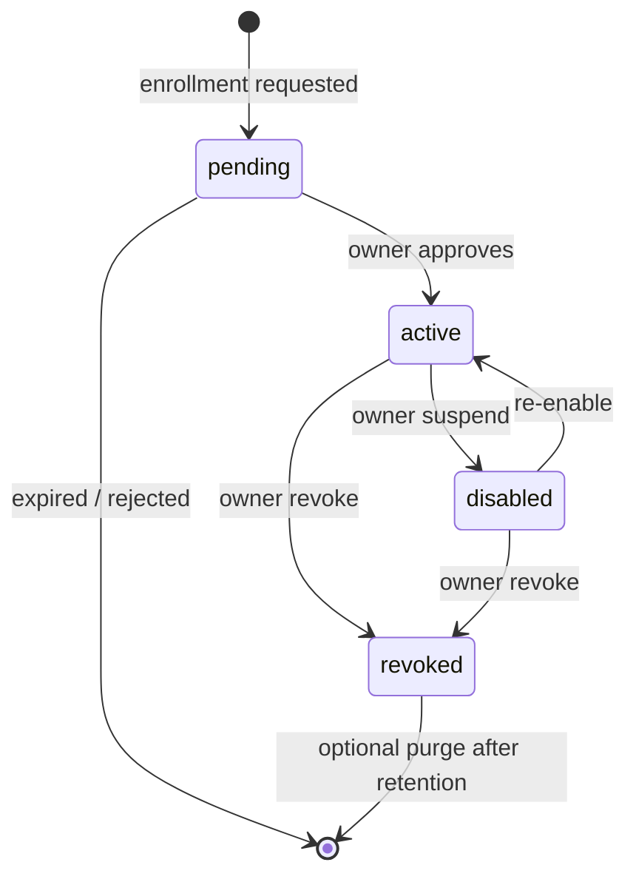

# Device registry (design — P1b.4a)

**Status:** Architecture only. No registry tables, pairing, or remote credentials exist in code.

## Purpose

Authoritative inventory of **clients** allowed to use Chief of Staff capabilities against `cosd`, independent of Tailscale membership or local filesystem access.

## Non-goals (P1b.4a)

- No enrollment UI.
- No live registry writes.
- No hardware fingerprinting beyond optional user-supplied platform strings.

## Device record (logical schema)

| Field | Type | Notes |
| --- | --- | --- |
| `device_id` | UUID v4 (stable) | Primary key; never derived from IP/MAC alone |
| `display_name` | string | User-editable |
| `category` | enum | `personal_mac`, `personal_iphone`, `partner_mac`, `school_ipad`, `future`, … extensible |
| `platform` | string | e.g. `macos-26`, `ios-19`; optional |
| `owner` | string | `owen`, `partner`, `school-managed`, unassigned |
| `trust_class` | enum | `owner`, `personal_trusted`, `partner`, `school_managed`, `readonly`, `capture_only`, `revoked` |
| `permission_profile_id` | UUID | Points at versioned profile document |
| `enrolled_at` | ISO8601 UTC | |
| `last_seen_at` | ISO8601 UTC | Updated on successful authenticated API use via gateway |
| `auth_state` | enum | `pending`, `active`, `disabled`, `revoked` |
| `credential_id` | opaque ref | Pointer to credential record in Keychain / secure enclave store — **not** stored inline |
| `app_version` | string | Last reported client build |
| `metadata` | JSON object | Bounded, non-secret tags (e.g. `raycast`, `chief-ios`) |

**Revoked** devices remain in registry for audit; `auth_state=revoked` blocks all gateway paths.

## Storage (future P1b.4b)

- SQLite table family under Chief private state (`ChiefOfStaff/cosd/`), WAL mode, same backup posture as task registry.
- Separate `device_credentials` table: only `credential_id`, `device_id`, `issued_at`, `expires_at`, `revoked_at` — **never** the secret bytes in SQLite.
- Secrets: macOS Keychain on primary Mac (host); iOS Keychain on mobile clients.

## Lifecycle

## Management surface (future P1d)

Chief.app **Device Management** (main process only):

- List / filter by category and trust.
- Rename, change permission profile, disable, revoke.
- View last connection, app version, recent security events (from audit).
- Initiate pairing (display QR / approve pending enrollment).

Raycast and mobile clients **must not** manage other devices.

## Relationship to network identity

| Layer | Identifies | Grants access? |
| --- | --- | --- |
| Tailscale node | Machine on tailnet | **No** (network reachability only) |
| Device registry | Client + profile | **Yes** (via gateway) |
| User (future) | Human operator | Constrains approvals, not automatic API auth |

## Audit hooks (required on implementation)

Each state transition emits hash-chained audit events: `device.enrolled`, `device.profile_changed`, `device.disabled`, `device.revoked` (see `docs/security/p1b4-threat-model.md`).

## API implications

Future authenticated routes under `/v1/devices/*` (gateway-admin only, owner profile). Remote clients never call these.

Stable read-only client contract remains `/v1/ask`, `/v1/tasks`, … with **device-scoped** credentials, not the daemon master token.
