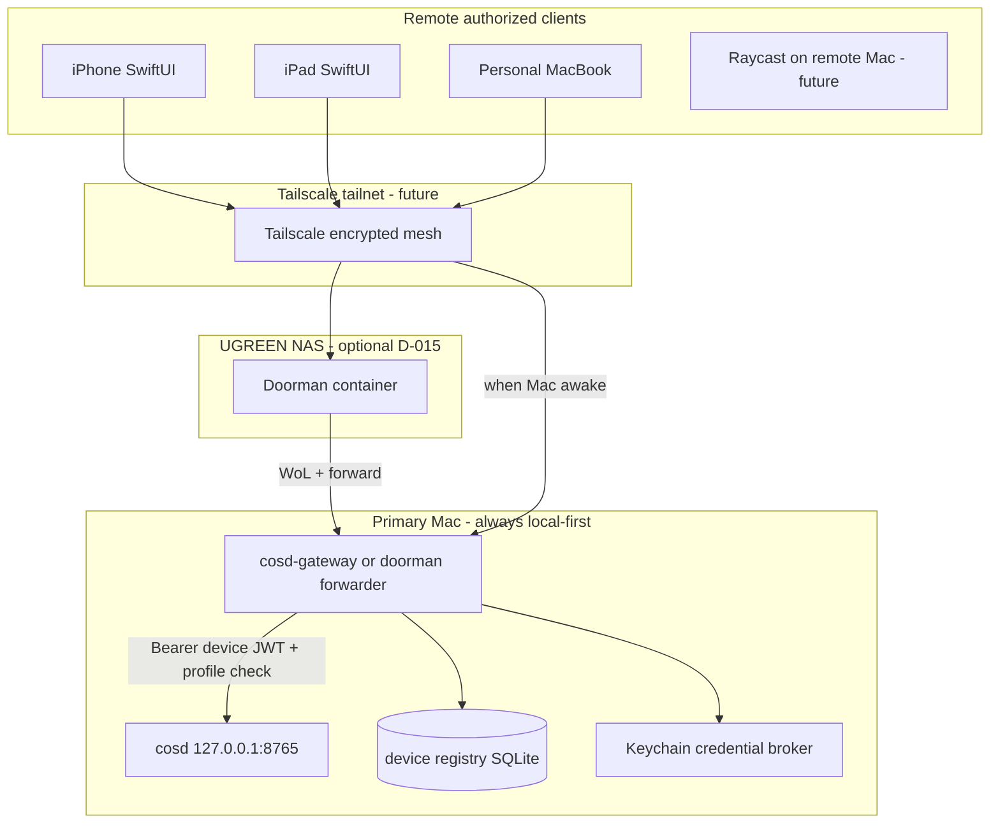

# Remote access gateway (design — P1b.4a)

**Status:** Architecture only. `cosd` remains `127.0.0.1` only. No gateway process ships in this phase.

## Decision summary

**Recommended:** **Option B — loopback `cosd` + authenticated local gateway** (with optional **D-015 NAS doorman** for wake/queue when the primary Mac sleeps).

| Option | Summary | Verdict |
| --- | --- | --- |
| A. `cosd` binds Tailscale IP | Single listener; simplest path | **Reject** — enlarges daemon attack surface; couples network policy to core runtime |
| B. Gateway on tailnet → loopback `cosd` | Separate process; device auth at edge | **Accept (recommended)** |
| C. Dedicated proxy service only | Similar to B with stricter isolation | **Accept** as variant of B for high-risk profiles |

ADR: `docs/architecture/adr-021-secure-multi-device-access.md`

## Topology

## Gateway responsibilities

1. **Terminate TLS** on tailnet interface (TLS 1.2+; cert from tailnet or local CA — implementation choice in P1b.4d).
2. **Authenticate device credential** (per-device secret or signed token; not master `api.token`).
3. **Authorize** each HTTP method/path against permission profile.
4. **Rate-limit** enrollment and failed auth.
5. **Proxy** allowed requests to `http://127.0.0.1:<port>/...` with optional request metadata headers (`X-Chief-Device-Id`, `X-Chief-Profile`) — **never** forward master bearer.
6. **Audit** allow/deny without logging secrets or student payloads.

## What the gateway must not do

- Store or learn the daemon master token for redistribution.
- Expose unauthenticated paths beyond documented health (if any).
- Bypass PolicyGate by inventing a second agent pipeline.
- Write to device registry without owner-profile credentials.

## NAS doorman (D-015 alignment)

When the Mac sleeps:

- Phone → doorman (always-on Tailscale).
- Doorman attempts WoL; waits for gateway health.
- If unreachable, **E2E encrypted queue** between phone and Mac (NAS sees ciphertext only).
- Doorman **does not** terminate device trust; it forwards to gateway or holds queue.

Conflicts: D-015 predates gateway detail; **no conflict** — doorman is transport/wake layer; gateway is app auth layer.

## Local clients unchanged (P1b.4a guarantee)

| Client | Path today | P1b.4a change |
| --- | --- | --- |
| Chief.app | Main reads `api.token`; loopback HTTP | **None** |
| Raycast | Reads `api.token`; loopback HTTP | **None** |
| `bin/cos` | Daemon client when `COS_USE_DAEMON=auto` | **None** |

Future: local clients may **optionally** use device credential + gateway on `127.0.0.1` for parity testing; production local path may remain direct loopback with **host profile** credential rotation separate from remotes.

## Failure modes

| Condition | User-visible behavior |
| --- | --- |
| Gateway down, cosd up | Local clients work; remote fails closed |
| cosd down | All clients see degraded; no silent CLI cloud fallback for mobile |
| Device revoked | Gateway 401; audit `device.auth_failed` |
| Tailscale down | Remote offline; local loopback unaffected |
| Master token rotated | Local clients refresh from disk; **remote device tokens unaffected** |

## Implementation phases

| Phase | Deliverable |
| --- | --- |
| P1b.4b | Registry schema, Keychain broker, device credential format |
| P1b.4c | Pairing + owner approval |
| P1b.4d | Gateway binary, TLS, Tailscale bind, ACL documentation |
| P1c | SwiftUI client uses device credential only |
| P1d | Chief.app device management UI |
