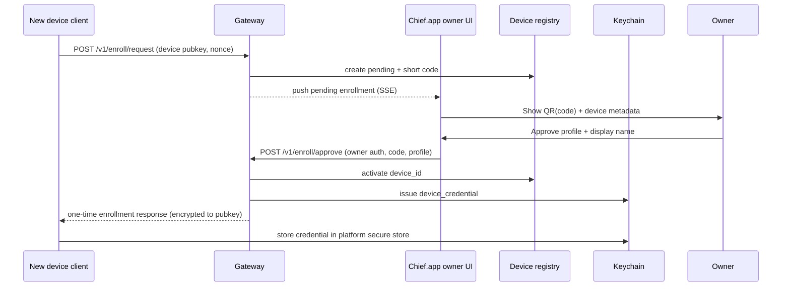

# P1b.4a — Secure multi-device access architecture

**Phase:** P1b.4a architecture; P1b.4b local identity/credential foundation
**Activation:** Local only. No network, remote pairing, Tailscale, or remote credential distribution in this milestone.

## Current-state inventory (verified)

| Capability | Status | Evidence |
| --- | --- | --- |
| Persistent `cosd` on loopback | **Implemented** | `cosd/server.py` `validate_bind_host` → `127.0.0.1` only |
| Single shared bearer `api.token` | **Implemented** | `cosd/auth.py`; Chief.app + Raycast read from `ChiefOfStaff/cosd/` |
| Task registry + execution queue | **Implemented** | P1b.1b–c |
| Chief.app / Raycast / `bin/cos` clients | **Implemented** | P1b.1e–3 |
| Device registry | **Implemented locally** | P1b.4b `cosd/devices/`; same SQLite file |
| Device permission profiles | **Implemented locally** | P1b.4b central authorization |
| Per-device credential foundation | **Implemented locally** | P1b.4b Keychain references + rotation/revocation; not distributed remotely |
| Device management API | **Implemented locally** | P1b.4b `/v1/devices` |
| Device pairing | **Implemented locally** | P1b.4c owner invitations, codes, approval, delivery envelope; remote delivery disabled |
| Tailscale / remote bind | **Not implemented** | Explicitly deferred in `cosd.md` and P1b.4d |
| NAS doorman (D-015) | **Not implemented** | Documented in DECISIONS only |
| HTTPS on cosd | **Not implemented** | — |
| iPhone SwiftUI client | **Not implemented** | D-007 ACCEPTED, future P1c |

**Conclusion:** Multi-device access is still **not activated**. P1b.4b establishes
local device identity, permissions, credentials, and revocation; remote
enrollment and network access remain P1b.4c/P1b.4d work.

## P1b.4b implementation status

The local foundation now exists:

- Device records persist in the existing cosd SQLite database with a separate
  `device_schema_version` migration.
- Device ids are random 128-bit values, stable across restarts, and independent
  of IP/hostname/name.
- Permission profiles are enforced centrally for master-token owner requests and
  independently authenticated `Chief-Device` principals.
- Device credentials are opaque `<credential_id>.<secret>` tokens; only a
  Keychain reference and a salted one-way verifier are stored in SQLite.
- Rotation, expiration, and revocation are implemented. Revocation is checked on
  every authorization decision; old credentials fail immediately.
- Device lifecycle and authentication events are written to the hash-chained
  audit log and a `device_events` table that survives device removal.
- The primary Mac can be bootstrapped as the owner device with explicit
  confirmation; the existing master token is unchanged.
- Chief.app has a local owner Devices screen.

Implementation names used in code are `personal`, `school`, and `read_only` for
the architecture table's `personal_trusted`, `school_managed`, and `readonly`.
The `ask` capability is a separate `ask` permission in code so school/partner
ask restrictions are enforceable without granting task read or execution.

Still disabled: remote QR pairing over a network, remote enrollment, Tailscale,
TLS gateway, remote credentials, and remote clients.

## P1b.4c implementation status

Pairing and enrollment now exist **locally**:

- The owner creates a pairing invitation; the daemon issues a 60-bit one-time
  code and a QR payload containing only enrollment id, code, and expiry.
- The enrolling device generates an X25519 keypair; only the public key is sent.
- The device redeems the code and binds its public key; state moves to
  `AWAITING_OWNER_APPROVAL`.
- The owner explicitly approves a profile (never automatically `owner`) in
  Chief.app. Rejection/cancellation are audited.
- The daemon issues a P1b.4b credential and encrypts a delivery payload with
  X25519 + HKDF-SHA256 + AES-256-GCM. The envelope is held in Keychain; SQLite
  stores only a reference and credential metadata.
- Codes are single-use, expire within 10 minutes, are salted-hash verified,
  rate-limited, and replayed codes are audited and denied.
- Re-pairing requires an explicit replacement of the existing key-bound device;
  the old identity is revoked and historical audit is preserved.

**Remote enrollment is not active.** All pairing endpoints are loopback-only.
P1b.4d must put the approved enrollment operations behind the authenticated TLS
gateway before any remote device can enroll. See
`docs/architecture/device-pairing-implementation.md`.

## Trust boundaries (six layers)

Network membership ≠ application authorization.

```text
1. Network (Tailscale ACL)     → which nodes may open TCP to gateway
2. Device identity             → registry record + credential
3. Application auth            → gateway validates device token
4. User identity (future)      → Face ID, owner approval for pairing
5. Authorization               → permission profile per route/method
6. Task execution permission   → existing PolicyGate + registered handlers
```

## Device ecosystem

Categories are **labels**, not hardcoded enums in source. Registry `category` is a string; UI may suggest:

- Personal: primary Mac, MacBook, iPad, iPhone
- Partner: MacBook, iPad
- School: MacBook Air, iPad
- Future: additional authorized workstations

Devices are added via pairing (P1b.4c), not code changes.

## Permission profiles (candidates)

| Profile ID | Ask | Capture task | List tasks | Cancel/retry | Execute task | Daemon admin | Device admin |
| --- | --- | --- | --- | --- | --- | --- | --- |
| `owner` | yes | yes | yes | yes | yes | yes | yes |
| `personal_trusted` | yes | yes | yes | limited | registered kinds | no | no |
| `partner` | policy | yes | shared slice | no | no | no | no |
| `school_managed` | restricted | yes | own tasks | no | no | no | no |
| `readonly` | no | no | filtered | no | no | no | no |
| `capture_only` | no | yes | own capture | no | no | no | no |
| `revoked` | no | no | no | no | no | no | no |

**Default for new enrollments:** `capture_only` or `readonly` until owner upgrades profile.

**Inheritance:** No automatic inheritance from owner. Partner/school devices never receive owner profile without explicit approval event (audited).

## Pairing protocol (implemented locally; remote gateway pending)

### Recommended flow



### Rules

- Pairing code TTL ≤ 10 minutes; single use.
- Rate limit: e.g. 5 failed enrollments / hour / source IP (tailnet).
- Owner approval mandatory; no silent self-enrollment.
- Re-pairing invalidates prior credential for same `device_id` unless owner selects "replace device".
- Revocation: mark `auth_state=revoked`; gateway deny-list in memory + persistent registry.

### Failure cases

| Event | Result |
| --- | --- |
| Expired code | 410; audit `pairing.expired` / `device.enrollment_failed` |
| Wrong owner session | 403 |
| Reused code | 409 |
| Downgrade attack (profile escalation request) | 403; audit |
| Client loses Keychain item | Owner-initiated re-pair |

## Authentication and credentials

### Today

- One `api.token` (256-bit hex) in `cosd/api.token`.
- Chief.app main process and Raycast Node runtime read file directly.
- **Must not** copy this token to iPhone, school iPad, or partner laptop.

### Target (P1b.4b+)

| Credential | Holder | Scope |
| --- | --- | --- |
| `daemon_master` | Primary Mac local clients (optional migration to Keychain) | Full loopback API when bound locally |
| `device_access` | Each enrolled device | Profile-limited; gateway validates |
| `enrollment_one_time` | Pairing exchange only | Minutes TTL |

Rotation:

- **Device revoke:** disable one `credential_id` without rotating master token.
- **Master rotate:** `bin/cosd rotate-token` affects local clients only; remotes use device credentials.
- **Compromise tailnet:** rotate device credentials per device; master optional.

Keychain (primary Mac): broker stores device issuance secrets and optional wrapped master for Chief.app — **migration deferred**.

iOS/iPadOS: Keychain + Face ID gate (D-007).

## Tailscale architecture (documented, not enabled)

- Private tailnet only; **no public port forward**.
- MagicDNS for stable names; ACLs deny by default.
- ACL grants: phone → `tag:chief-gateway` TCP 443 (example), not `tag:everyone → *`.
- Mac cosd **not** in ACL as a target; only gateway port.
- Device identity in Tailscale ≠ Chief device registry (both required).

Cost: existing Tailscale plan assumed; no new paid auth vendor.

## School vs personal boundaries

| Data / action | Personal trusted | School managed |
| --- | --- | --- |
| General ask | yes | curated (no student PII in prompts) |
| Personal session history | yes | **no** |
| Student-related content | owner policy | **deny by default** |
| Task capture | yes | yes (non-executable kinds) |
| Task execute | registered handlers | **no** |
| Device admin | no | **no** |
| Credential on device | user Keychain | **no master token**; MDM may wipe |

Partner devices: explicit shared profile; no access to owner-only history unless profile grants.

## Platform-independent API contract

Remote clients use the same **versioned** JSON API as `docs/architecture/cosd-api-contract.md` with these additions (future):

- Gateway may require `Authorization: Chief-Device <token>` scheme (distinct from daemon bearer).
- Optional `Idempotency-Key` unchanged for tasks.
- No Raycast-specific APIs on mobile.

SwiftUI (P1c): ask, capture, status, notifications, pairing; no desktop-only lifecycle in mobile v1.

## Audit events (security extension)

Extend hash-chained audit with kinds (no secrets in fields):

`pairing.requested`, `pairing.code_generated`, `pairing.redeemed`, `pairing.approved`, `pairing.rejected`, `pairing.expired`, `pairing.cancelled`, `pairing.replay_denied`, `pairing.completed`, `device.enrolled`, `device.enrollment_failed`, `device.credential_issued`, `device.replaced`, `device.auth_ok`, `device.auth_failed`, `device.profile_changed`, `device.credential_rotated`, `device.disabled`, `device.revoked`, `remote.task_created`, `remote.task_execute_denied`, `gateway.request_denied`.

Fields: `enrollment_id` (pairing), `device_id`, `profile_id`, `route`, `result`, `task_id` (if any).

## Implementation roadmap (dependencies)

```text
P1b.4a (docs) ──► P1b.4b identity + credential foundation (local)
                 └─► P1b.4c pairing + approval + local delivery envelope (local)
                      ├─► P1b.4d Tailscale + gateway + TLS
                      ├─► P1c iPhone/iPad SwiftUI (depends 4b–4d)
                      └─► P1d device management UI (basic P1b.4b/P1b.4c screens exist)
```

P1b.4d should not ship before 4b (credentials) and 4c (pairing) or gateway would lack authoritative registry.

## Related documents

- `docs/architecture/device-registry.md`
- `docs/architecture/remote-access-gateway.md`
- `docs/security/p1b4-threat-model.md`
- `docs/architecture/adr-021-secure-multi-device-access.md`

## P1b.4a compliance

P1b.4a made no code or credential changes. P1b.4c now implements local pairing
and enrollment only; it does not install Tailscale, change the cosd bind, migrate
the master token, enable a gateway, or issue credentials to remote clients.
